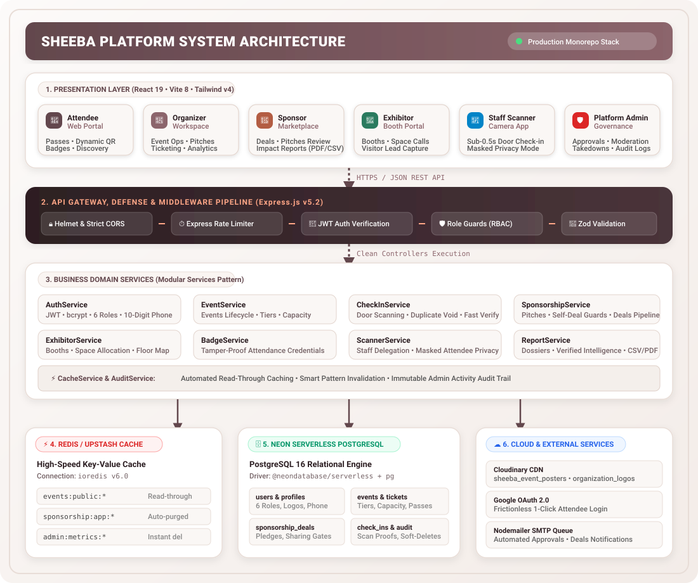

# Sheeba Platform: Technology Stack & System Architecture

This document provides a comprehensive overview of the programming languages, software packages, exact dependency versions, and system architecture powering the **Sheeba** platform.

---

## Part 1: Programming Languages, Runtimes & Package Versions

### 1. Core Languages & Execution Runtimes

| Technology | Exact Version | Purpose & Scope |
| :--- | :--- | :--- |
| **TypeScript** | `~6.0.2` (Frontend) / `^5.9.3` (Backend) | End-to-end static typing across both client and server applications |
| **Node.js** | `v18+` / `v20+` / `v22+` (Runtime: `v22.18.0`) | JavaScript runtime for backend API execution and build tooling |
| **SQL (PostgreSQL)** | `PostgreSQL 16` | Relational database schema, relational constraints, indexing, aggregations |
| **HTML5 & CSS3** | Latest Standards | Semantic structure and responsive layout rendering |

---

### 2. Frontend Dependencies (`frontend/package.json`)

#### Production Dependencies
| Package | Version | Purpose |
| :--- | :--- | :--- |
| **`react`** | `^19.2.8` | Core UI library for building reactive client components |
| **`react-dom`** | `^19.2.8` | DOM rendering layer for React 19 |
| **`react-router-dom`** | `^7.18.2` | Client-side routing, navigation guards, and role-based redirects |
| **`tailwindcss`** | `^4.3.3` | Utility-first CSS styling engine |
| **`@tailwindcss/vite`** | `^4.3.3` | High-speed Tailwind compiler plugin for Vite |
| **`clsx`** | `^2.1.1` | Conditional CSS class constructor |
| **`tailwind-merge`** | `^3.6.0` | Conflict-free utility class merging |
| **`lucide-react`** | `^1.33.0` | Vector icon system across all interfaces |
| **`zod`** | `^4.6.5` | Client-side schema validation for forms and inputs |
| **`@react-oauth/google`** | `^0.13.5` | Google Identity Services OAuth 2.0 login integration |
| **`qrcode.react`** | `^4.2.0` | Client-side dynamic QR code rendering for digital attendee tickets |
| **`html5-qrcode`** | `^2.3.8` | In-browser camera QR code scanner for door check-in staff |

#### Development & Build Tooling
| Package | Version | Purpose |
| :--- | :--- | :--- |
| **`vite`** | `^8.2.0` | Ultra-fast frontend bundler and local development server |
| **`@vitejs/plugin-react`** | `^6.0.4` | Vite plugin providing React Fast Refresh and JSX transformation |
| **`typescript`** | `~6.0.2` | TypeScript compiler for client bundle |
| **`@types/react`** | `^19.2.17` | TypeScript type declarations for React |
| **`@types/react-dom`** | `^19.2.3` | TypeScript type declarations for React DOM |
| **`@types/node`** | `^24.13.3` | TypeScript type declarations for Node.js |
| **`oxlint`** | `^1.75.0` | High-speed JavaScript/TypeScript linter |
| **`sharp`** | `^0.35.4` | High-performance image conversion and asset optimization |
| **`tsx`** | `^4.23.15` | Fast TypeScript execution runtime for frontend test scripts |

---

### 3. Backend Dependencies (`backend/package.json`)

#### Production Dependencies
| Package | Version | Purpose |
| :--- | :--- | :--- |
| **`express`** | `^5.2.1` | Web application framework powering the REST API |
| **`pg`** | `^8.23.0` | PostgreSQL client and connection pooling |
| **`@neondatabase/serverless`** | `^1.1.0` | Serverless PostgreSQL driver for Neon database connectivity |
| **`ioredis`** | `^6.0.0` | High-performance client for Redis / Upstash caching |
| **`jsonwebtoken`** | `^9.0.3` | JSON Web Token (JWT) issuance, signing, and verification |
| **`bcryptjs`** | `^3.0.3` | Salt generation and cryptographic password hashing |
| **`zod`** | `^4.6.5` | Server-side request validation (body, query, and URL parameters) |
| **`helmet`** | `^8.3.0` | HTTP security headers configuration (XSS, CSP, HSTS, Sniff protection) |
| **`cors`** | `^2.8.6` | Cross-Origin Resource Sharing control |
| **`express-rate-limit`** | `^8.7.0` | API rate limiting to mitigate brute-force and DDoS attacks |
| **`nodemailer`** | `^9.1.1` | Transactional email delivery engine with background queue |
| **`google-auth-library`** | `^11.0.2` | Google OAuth token verification for social authentication |
| **`qrcode`** | `^1.5.4` | Server-side encrypted QR code pass generator |
| **`dotenv`** | `^17.4.2` | Environment variable loader from `.env` |

#### Development & Testing Dependencies
| Package | Version | Purpose |
| :--- | :--- | :--- |
| **`typescript`** | `^5.9.3` | TypeScript compiler for backend |
| **`ts-node`** | `^10.9.2` | Direct execution of TypeScript files during testing and migrations |
| **`ts-node-dev`** | `^2.0.0` | Automatic restart dev server with transpilation caching |
| **`copyfiles`** | `^2.4.1` | Asset copy utility (e.g. copying `schema.sql` into `dist/`) |
| **`@types/express`** | `^5.0.6` | TypeScript type declarations for Express |
| **`@types/pg`** | `^8.23.1` | TypeScript type declarations for PostgreSQL client |
| **`@types/jsonwebtoken`** | `^9.0.10` | TypeScript type declarations for JWT |
| **`@types/bcryptjs`** | `^2.4.6` | TypeScript type declarations for bcrypt |
| **`@types/nodemailer`** | `^8.0.1` | TypeScript type declarations for Nodemailer |
| **`@types/qrcode`** | `^1.5.6` | TypeScript type declarations for QR Code |
| **`@types/cors`** | `^2.8.19` | TypeScript type declarations for CORS |
| **`@types/node`** | `^26.2.0` | TypeScript type declarations for Node runtime |

---

### 4. Cloud Infrastructure & External Services

- **Database Server:** [Neon Serverless PostgreSQL 16](https://neon.tech/) (Auto-scaling, connection pooled)
- **Distributed Cache:** [Redis / Upstash Serverless Redis](https://upstash.com/) (Key-value cache, pattern invalidation, rate limiter)
- **Asset CDN & Cloud Storage:** [Cloudinary](https://cloudinary.com/) (Image hosting for event posters, organizer logos, and sponsor assets)
- **Identity Provider:** [Google Identity Services / OAuth 2.0](https://developers.google.com/identity)
- **Email Delivery Gateway:** SMTP via Nodemailer (with async background retry queues)

---

## Part 2: Sheeba System Architecture

Sheeba is built on a **Layered Service-Oriented Monorepo Architecture**. The platform cleanly decouples client interfaces, API routing, business domain services, in-memory caching, and relational persistence.

### Visual Architecture Diagram



```
┌────────────────────────────────────────────────────────────────────────────────────────────────────────┐
│                        1. CLIENT PRESENTATION LAYER (React 19 • Vite 8 • Tailwind v4)                  │
├──────────────┬──────────────┬──────────────┬──────────────┬─────────────────────────┬──────────────────┤
│   ATTENDEE   │  ORGANIZER   │   SPONSOR    │  EXHIBITOR   │      STAFF SCANNER      │  PLATFORM ADMIN  │
│  Web Portal  │  Workspace   │ Marketplace  │ Booth Portal │  Fast QR Camera Scanner │    Governance    │
│  Passes & QR │ Events & Ops │ Deals & Pdfs │ Booth & Leads│ Masked Privacy (Sub-0.5s│ Approvals & Audit│
└──────┬───────┴──────┬───────┴──────┬───────┴──────┬───────┴────────────┬────────────┴─────────┬────────┘
       │              │              │              │                    │                      │
       └──────────────┴──────────────┴───────┬──────┴────────────────────┴──────────────────────┘
                                             │ HTTPS / REST API Requests
                                             ▼
┌────────────────────────────────────────────────────────────────────────────────────────────────────────┐
│                        2. API GATEWAY, DEFENSE & MIDDLEWARE (Express.js v5.2)                          │
├───────────────────┬───────────────────┬─────────────────────┬───────────────────┬──────────────────────┤
│  Helmet & CORS    │  Rate Limiter     │ JWT Auth Validation │ Role Guards(RBAC) │ Zod Schema Validator │
│ Security Headers  │ Anti-Brute Force  │ Stateless Tokens    │ 6 Protected Roles │ Strict Data Shapes   │
└───────────────────┴───────────────────┴──────────┬──────────┴───────────────────┴──────────────────────┘
                                                   │ Clean Controller Invocation
                                                   ▼
┌────────────────────────────────────────────────────────────────────────────────────────────────────────┐
│                        3. BUSINESS DOMAIN SERVICES (Modular Services Pattern)                          │
├─────────────────────┬─────────────────────┬───────────────────────┬────────────────────────────────────┤
│ AuthService         │ EventService        │ CheckInService        │ SponsorshipService                 │
│ JWT • bcrypt • Auth │ Events & Tickets    │ Door QR Verification  │ Pitches • Anti-Self-Deals • Deals  │
├─────────────────────┼─────────────────────┼───────────────────────┼────────────────────────────────────┤
│ ExhibitorService    │ BadgeService        │ ScannerService        │ ReportService                      │
│ Booths & Floor Space│ Attendance Badges   │ Staff Key Delegation  │ Performance Dossiers (CSV & PDF)   │
├─────────────────────┴─────────────────────┴───────────────────────┴────────────────────────────────────┤
│ ⚡ CacheService: Read-Through Caching & Invalidation  •  🛡️ AuditService: Immutable Activity Logging   │
└───────────────────┬──────────────────────────────────┬─────────────────────────────────┬───────────────┘
                    │                                  │                                 │
         Cache Read │ Write                 Query / DB │ Transactions       File Uploads │ / OAuth
                    ▼                                  ▼                                 ▼
┌───────────────────────────────┐  ┌────────────────────────────────┐  ┌─────────────────────────────────┐
│  4. REDIS / UPSTASH CACHING   │  │ 5. NEON SERVERLESS POSTGRES 16 │  │ 6. CLOUD & EXTERNAL SERVICES    │
├───────────────────────────────┤  ├────────────────────────────────┤  ├─────────────────────────────────┤
│ • Key-Value Fast Store        │  │ • Primary Relational Database  │  │ • Cloudinary (Posters & Logos)  │
│ • events:public:* cache       │  │ • users, events, tickets       │  │ • Google Identity OAuth 2.0     │
│ • sponsorship:app:* cache     │  │ • sponsorship_deals, check_ins │  │ • Nodemailer SMTP Queue         │
│ • admin:metrics:* cache       │  │ • Foreign Keys & Soft Deletes  │  │ • Cryptographic QR Generator    │
└───────────────────────────────┘  └────────────────────────────────┘  └─────────────────────────────────┘
```

---

### Architectural Layer Breakdown

#### 1. Presentation Layer (Client Application)
- **Architecture:** Client-Side Rendered Single Page Application (SPA) built with React 19 and React Router v7.
- **Role-Based Workspaces:** Dedicated interfaces tailored for 6 distinct personas:
  1. **Attendee:** Event discovery, ticket pass collection with dynamic QR codes, profile settings, and verified attendance badges.
  2. **Organizer:** Event creation, ticket tier pricing, real-time ticket analytics, speaker management, sponsor pitch creation, and attendee management.
  3. **Sponsor:** Sponsorship marketplace discovery, one-click pitch review, proposal formalization, and performance dossiers with verified attendee analytics.
  4. **Exhibitor:** Booth space applications, product showcases, and visitor lead capture.
  5. **Door Scanner:** Minimalist, fast, camera-driven ticket QR code validator designed for venue staff with attendee privacy masking.
  6. **Platform Administrator:** User approvals, content moderation, pitch take-down controls, platform audit logs, and global ecosystem metrics.
- **Styling & Assets:** Utility-based Tailwind CSS v4 design system with custom brand tokens (`#63474D` primary, `#FFA686` accent), optimized WebP imagery, and responsive layouts.

---

#### 2. Gateway, Security & Middleware Layer
All requests pass through a defensive middleware pipeline before reaching business logic:
- **`Helmet` & `CORS`:** Restricts cross-origin leaks, prevents clickjacking, enforces MIME type sniffing protections, and sets strict Content Security Policies.
- **`express-rate-limit`:** Throttles high-frequency endpoints (e.g. login, registration, OTP requests) to prevent brute-force attacks.
- **Authentication & RBAC (`authorizeRoles`):** Validates stateless JSON Web Tokens (JWT) extracted from HTTP Authorization headers and verifies that the user's role has permission to access the requested route.
- **Request Validation (`Zod`):** Validates payload shapes against strict TypeScript/Zod schemas before executing database queries, guaranteeing clean input data.

---

#### 3. Core Business Service Layer (Service-Oriented Pattern)
Business rules are isolated into dedicated, testable domain services rather than mixed into HTTP routes:
- **`AuthService`:** User registration, password encryption with `bcryptjs`, Google SSO credential validation, multi-role assignment, and session token issuance.
- **`EventService`:** Life-cycle management of events (draft, published, completed, cancelled), ticketing tiers, capacity limits, and categorization.
- **`CheckInService`:** Decrypts ticket QR passes, validates against the event database, records check-in timestamps, and prevents ticket reuse in under 0.5 seconds.
- **`SponsorshipService`:** Manages the sponsorship pipeline:
  - Organizers publish sponsorship pitches with custom funding goals and tiered benefit packages.
  - Sponsors discover opportunities, express interest, or submit formal proposals.
  - Organizers accept deals and control granular privacy gates (e.g. `allow_attendee_sharing`).
  - Guards prevent self-deals (an organizer cannot sponsor their own pitch).
- **`ScannerService`:** Enables organizers to delegate door scanning credentials to staff without granting access to sensitive organizer financial or contact data.
- **`BadgeService`:** Generates tamper-proof digital attendance credentials for attendees who check in at events.
- **`AuditService`:** Immutable event logging that records critical administrative actions (approvals, deletions, moderations) for governance.
- **`ReportService`:** Aggregates event performance into exportable proof-of-performance impact reports (CSV and printable PDF dossiers).

---

#### 4. Caching & Performance Layer (`CacheService`)
- Powered by **Redis / Upstash Redis** via `ioredis`.
- Implements **Read-Through Caching** on high-traffic, read-heavy endpoints:
  - Published event listings (`events:public:*`)
  - Sponsorship marketplace pitches (`sponsorship:app:*`)
  - Admin dashboard metrics (`admin:dashboard:metrics`)
- **Smart Pattern Invalidation:** When an event or pitch is updated, deleted, or taken down, the service uses pattern deletion (`delPattern('sponsorship:app:*')`) to instantly purge stale cache entries across all nodes.

---

#### 5. Data Persistence Layer (PostgreSQL)
- **Database Engine:** Managed PostgreSQL 16 hosted on **Neon Database Serverless**.
- **Relational Integrity:** Foreign key constraints, cascading rules, unique indexes (e.g. preventing duplicate deal expressions or duplicate ticket registrations), and indexed search columns.
- **Soft-Delete Architecture:** Critical entities (`events`, `sponsorship_applications`, `sponsorship_deals`, `users`) utilize `deleted_at` and `deleted_by` timestamp columns. Deleted items move to a platform **Recycle Bin** and can be restored, preventing accidental data loss.

---

#### 6. External Cloud Integrations
- **Cloudinary:** All media files (organization logos, company logos, event poster banners, proof-of-payment bank receipts) are uploaded directly to organized cloud folders (`sheeba_event_posters`, `sheeba_organization_logos`, `sheeba_sponsor_logos`) and stored as permanent HTTPS URLs in PostgreSQL.
- **Google Identity Platform:** OAuth 2.0 verification for frictionless, one-click sign-in.
- **Nodemailer / SMTP:** Asynchronous queue sending automated emails for organizer approvals, password setups, and accepted sponsorship deal notifications.
- **Dynamic QR Code Engine:** Uses cryptographic hashes to generate verifiable QR passes for attendees and tickets.

